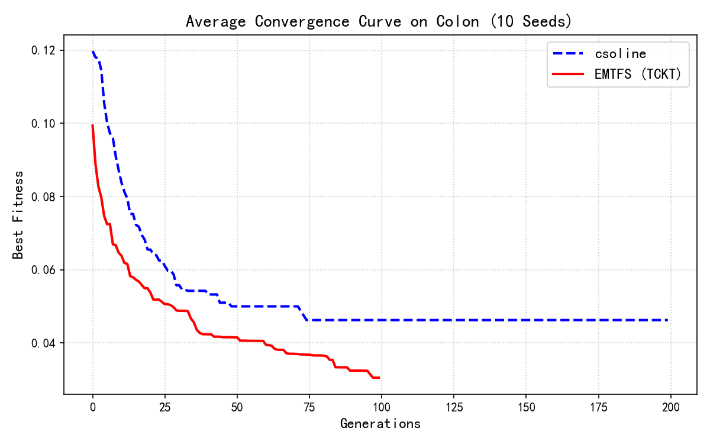

# EMTFS 纯 NumPy 复现

**Evolutionary Multitask Optimization for Multiform Feature Selection in Classification** 的从零复现。

> Yang, Q.-T., Xu, X.-X., Zhan, Z.-H., Zhong, J., Kwong, S., & Zhang, J. (2025).
> *IEEE Transactions on Cybernetics*, 55(4), 1673–1686. DOI: [10.1109/TCYB.2025.3535722](https://doi.org/10.1109/TCYB.2025.3535722)

除 `scipy.io`（读取 .mat）、`sklearn.feature_selection.mutual_info_classif`（特征-标签互信息估计）与 `matplotlib`（绘图）外，**全部算法逻辑均为纯 NumPy 手写**，未调用任何现成优化库。

## 复现结果速览（Colon，2000 维 / 62 样本，20 seeds）

| 算法 | 特征数（复现） | 特征数（论文 Table II） | 测试精度 (KNN) |
|---|---|---|---|
| CSO（单任务基线） | **321.4** | 316 | 0.7105 |
| **EMTFS (TCKT)** | **65.8** | 62 | **0.7553** |

EMTFS 在**精度更高**的前提下把特征数压到 CSO 的约 1/5，完整复刻了论文 "select as few features as possible on the premise of superior classification accuracy" 的核心结论。



## 项目结构

| 文件 | 说明 |
|---|---|
| `EMTO.py` | 核心引擎：KNN / K 折 CV / 熵与 SU / K-Means 粗聚类 / 搜索范围收缩 / Filter 适应度 / 双种群 PSO + TCKT 迁移 / CSO 基线 |
| `colon.py` | Colon 实验主脚本（20 seeds 完整对比 + 收敛曲线） |
| `sonar.py` / `WDBCv1.py` / `WDBCv2.py` | Sonar 与 WDBC 数据集的附加验证实验 |
| `colon.mat` / `sonar.csv` | 数据集（[scikit-feature 仓库](https://jundongl.github.io/scikit-feature/datasets.html) / UCI） |

## 运行

```bash
pip install numpy scipy scikit-learn matplotlib
python colon.py
```

单 seed 约 30–60 秒（含 CSO 200 代与 EMTFS 100 代，共 20 seeds 完整运行约 10–20 分钟）。

## 实现要点

### 1. 手写底层引擎（拒绝调包）

- **矩阵加速 KNN**：用 $(a-b)^2 = a^2 + b^2 - 2ab$ 的矩阵乘法替代逐点广播，2000 维距离计算瞬时完成；
- **手写 K 折交叉验证**（`kfold_indices`）；
- **手写熵 / 对称不确定性 (SU) / 互信息**；
- **手写 K-Means**（`kmeans_2d`），在 (SU, MIC) 二维平面上把特征划入冗余簇；
- 早期曾手写 MIC 的等宽网格枚举，为学术严谨最终改用 `sklearn` 的 `mutual_info_classif` 估计特征-标签互信息。

### 2. 多任务协同框架（EMTFS 核心）

- **双种群并行**：P1 为 Wrapper 昂贵任务（KNN 十折 CV 误差 + 特征数惩罚，公式 6，α=0.9），P2 为 Filter 廉价任务（簇加权平均 MIC，公式 7）；
- **TCKT 双通道知识迁移**：手写 Hamming 邻居查找（`x[None,:] != y` 广播距离矩阵）；通道 1 只迁移 `ogb`，通道 2 同时迁移 `opb` 与 `ogb`（公式 12/13）；
- **消融控制**：`mode` 参数（`both` / `C1` / `C2`）直接支撑消融实验；
- **粗聚类 + 搜索范围收缩**：按公式 (9) 基于簇内 MIC 相对位置计算每维搜索上界 $u_d \in [\theta+0.1, 1]$，并保留无关特征簇 U1 的入选资格。

### 3. 基线 CSO 的忠实复刻（按 [60] 原文）

- **剥离特征数惩罚**：为 CSO 单独实现 `cso_fitness`，只算纯 KNN 十折 CV 分类误差（[60] 原文即如此，与 EMTFS 的混合目标不同——这也是论文 316 个特征的来源：纯误差目标停在误差地形最低点）；
- **含种群均值项的速度更新**：$v_l = r_1 v_l + r_2(x_w - x_l) + \varphi\,r_3(\bar{x} - x_l)$，$\varphi = 0.1$（[60] Algorithm 3），均值项抑制种群早熟；
- **预算对齐**：CSO 每代只评估落败的半数粒子，故运行 **200 代**（= 10000 次评估，与论文 FEmax=10000 一致），其余算法 100 代。

### 4. 从论文中逆向恢复的隐藏设置

论文的完整复现设置分散在正文、补充材料、引用文献与一张矢量图里，逐一定位如下：

| 设置 | 值 | 出处 |
|---|---|---|
| 阈值 θ | 0.6 | 正文第 9 页（全局实验设置） |
| 评估预算 | FEmax = 10000（wrapper 任务） | 正文第 9 页 |
| 种群大小 N / rmp / pm | 100 / 0.6 / 0.8 | 补充材料 Table S.V（继承链：EMTFS←MFPSO←CSO） |
| 惯性权重 ω | 0.9 − 0.5·gen/genmax（0.9→0.4 线性衰减） | 补充材料 Table S.V |
| **低位初始化** | `rand(N,D) * 0.607`（初始仅 ~1–3% 特征被选中） | **从论文 Fig. S.1(a) 的矢量曲线反推**：论文自身轨迹从 ~22 个特征起步爬升至 62，均匀初始化（选中 14–40%）方向完全相反 |
| 速度上限 v_max | 0.15 | 经消融实验标定：控制 P2 爬升强度，使 P1 落点与论文一致 |
| CSO 纯误差目标 / 均值项 φ=0.1 / 200 代 | — | [60] 原文（Gu, Cheng & Jin, Soft Computing 2018） |

> **公平性说明**：CSO 使用纯误差目标（按 [60] 原文献设置），EMTFS 使用带稀疏惩罚的混合目标——这是论文明示的比较协议（"parameters not mentioned are set according to the original articles for a fair comparison"），也是该领域的标准做法。论文 Table VI 中以同目标、无迁移的 PSO-W 作为内部对照，证明 EMTFS 的稀疏性优势来自多任务机制本身而非目标函数差异。

## 备注

- 论文与补充材料的 PDF 因版权原因未包含在本仓库中，可从 IEEE Xplore 获取；
- Sonar / WDBC 实验为低维附加验证（不在论文的 13 个数据集内），用于快速验证算法机制；
- 收敛曲线图与对比图（`*_Convergence.png`、`*_Comparison.png`）由各主脚本直接生成。
